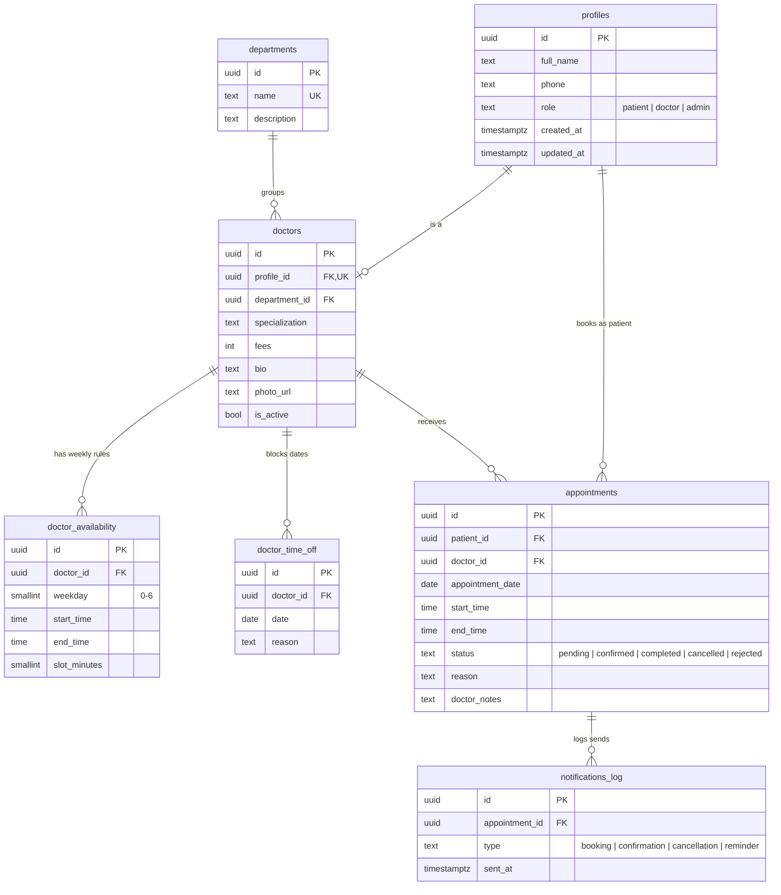

# MediBook

A hospital and clinic appointment system. Patients find doctors and book free slots, doctors manage their schedules and appointments, and admins manage doctors, departments and reports. Built as a B.Tech CSE final year project.

## Features

- **Patients** — browse and search doctors by name or department, pick a date and slot, request an appointment, track upcoming and past visits, cancel, and edit their profile.
- **Doctors** — set weekly availability and time off, confirm/reject/complete appointments, add visit notes, and manage their public profile and photo.
- **Admins** — manage departments and doctors, oversee every appointment, view reports (appointments per day/doctor/department, busiest hour, cancellation rate) and check system settings.
- **Guarantees** — a partial unique index makes double booking impossible; Row Level Security enforces every role boundary; free slots are calculated, never stored.
- **Notifications** — booking, confirmation and cancellation emails through Resend, plus an hourly pg_cron job that sends one reminder about 24 hours before each confirmed appointment.

## Stack

React 18 · TypeScript · Vite · Tailwind CSS · shadcn/ui · TanStack Query · React Hook Form + Zod · Supabase (Postgres, Auth, Realtime, Storage, Edge Functions) · Recharts · date-fns

All application tables live in the `medibook` schema, not `public`.

## Getting started

### Prerequisites

- Node.js 20+ and npm
- A Supabase project and the [Supabase CLI](https://supabase.com/docs/guides/cli) for database and function deploys
- Optional: a [Resend](https://resend.com) API key for email

### 1. Install

```bash
npm install
```

### 2. Configure the frontend

Create `.env.local` from `.env.example`:

```bash
VITE_SUPABASE_URL=https://your-project.supabase.co
VITE_SUPABASE_ANON_KEY=your-anon-key
# Set to true only after deploying send-appointment-email and configuring Resend.
VITE_ENABLE_EMAILS=false
```

Only the anon key belongs in the frontend. Service role and Resend keys stay in Edge Function secrets.

### 3. Apply the database migrations

Migrations create the `medibook` schema, tables, indexes, RLS policies, the `doctor-photos` storage bucket, the realtime publication and seed departments.

```bash
supabase link --project-ref <your-project-ref>
supabase db push
```

If the schema is not exposed through the API, run the migration's final `alter role authenticator set pgrst.db_schemas = ...` statement and reload PostgREST; the SQL already includes `notify pgrst, 'reload config'`.

### 4. Create Edge Functions (optional until email is needed)

```bash
supabase functions deploy send-appointment-email
supabase functions deploy send-reminders --no-verify-jwt
supabase functions deploy admin-create-doctor

supabase secrets set RESEND_API_KEY=re_...
supabase secrets set REMINDER_FROM_EMAIL="MediBook <appointments@yourdomain.com>"
supabase secrets set CRON_SECRET=<long-random-value>
```

Then set `VITE_ENABLE_EMAILS=true` and restart the dev server. Schedule reminders with `supabase/cron/schedule_reminders.sql.example`. See `supabase/functions/README.md` for details.

### 5. Create the first admin

Sign up normally, then promote the account from the SQL editor (only admins may change roles, so this one manual step bootstraps the system):

```sql
update medibook.profiles set role = 'admin' where id = '<your-auth-user-id>';
```

### 6. Run

```bash
npm run dev
```

The app is at http://localhost:5173.

## Scripts

| Command             | Purpose                                          |
| ------------------- | ------------------------------------------------ |
| `npm run dev`       | Start the Vite dev server                        |
| `npm run build`     | Type-check the project and build to `dist/`      |
| `npm run preview`   | Serve the production build locally               |
| `npm run typecheck` | Type-check without emitting                      |

There is no test runner configured yet.

## Project structure

```
src/
  components/
    layout/      AppShell, Sidebar, Topbar, protected route, auth layout
    shared/      StatusBadge, EmptyState, ErrorState, MetricCard, dialogs
    ui/          Generated shadcn/ui primitives (do not hand-edit)
  features/
    appointments/  API, hooks, realtime, status actions, notes dialog
    auth/          AuthProvider, forms, role helpers
    availability/  availability and time-off API, slot generation
    departments/   department API, hooks, dialog
    doctors/       doctor API, hooks, cards and dialogs
    reports/       aggregation and report hooks
  pages/         Route-level screens: landing, auth, patient/*, doctor/*, admin/*
  lib/           Supabase client, query client, date/format helpers
  types/         Shared types and generated database types
supabase/
  migrations/    Schema, indexes, RLS, storage, realtime, seed
  functions/     Edge Functions and cron example
context/         Project specs: overview, architecture, standards, UI, progress
```

## Data model



### Key invariants

1. **No double booking**: unique index on `(doctor_id, appointment_date, start_time)` where the status is not `cancelled` or `rejected`.
2. **Authorization in RLS**, not just hidden buttons: patients see only their appointments, doctors only theirs, admins everything.
3. **Slots are derived** from availability minus time off minus active appointments.
4. **Reminders are idempotent** through the unique `(appointment_id, type)` on `notifications_log`.
5. **Roles cannot be self-assigned**; a trigger rejects role changes from non-admins.

## Deployment

- Frontend: deploy to Vercel (Vite preset), with `VITE_SUPABASE_URL`, `VITE_SUPABASE_ANON_KEY` and `VITE_ENABLE_EMAILS` set in the project environment.
- Backend: `supabase db push` for migrations, deploy the three Edge Functions, and add the pg_cron schedule from `supabase/cron/schedule_reminders.sql.example`.
- Before a demo, book one appointment as a patient and confirm it as a doctor to verify RLS end to end.
